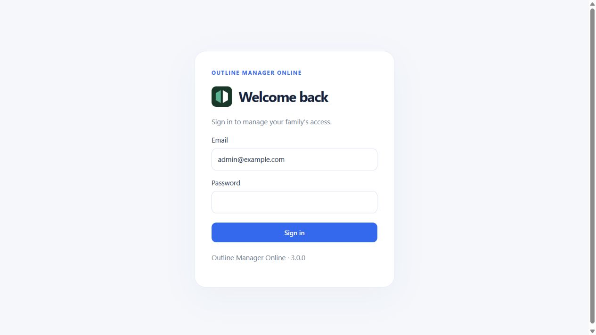
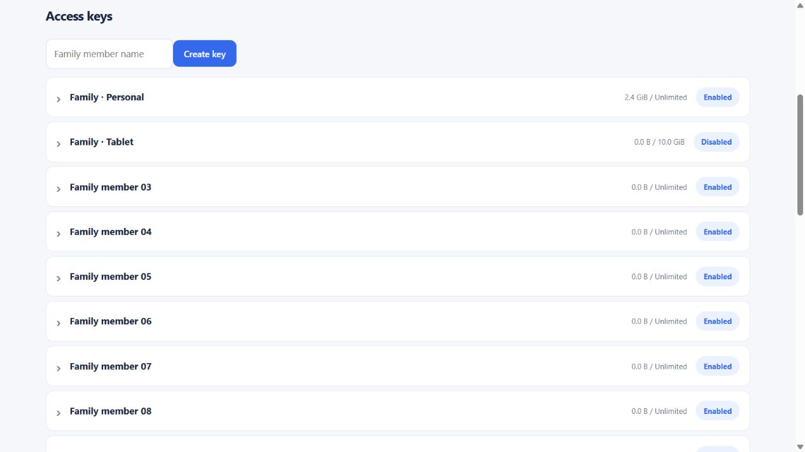
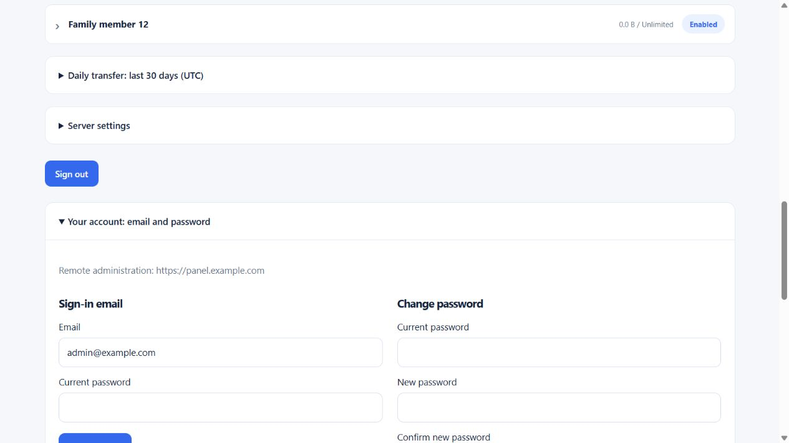

# Outline Manager Online

A self-hosted browser dashboard for managing an Outline-compatible Shadowsocks-over-WebSocket server. Designed for small family deployments on ZimaOS or Docker, including homes behind CGNAT using an existing Cloudflare Tunnel.

**Independent community project. Not the official Outline Manager and not affiliated with Outline Foundation, Jigsaw, Google, or Cloudflare.**

## Screenshots

These are screenshots of the actual application rendered with **demo data**. They contain no working access keys or personal account information.





## Features

- Email/password sign-in, direct dashboard redirect, and sign-out.
- Change the admin email and password after confirming the current password.
- Create and rename individual access keys; copy dynamic `ssconf://` links and generate QR codes locally.
- Enable/disable access; archive keys and restore them in a disabled state.
- Measured upload/download totals per key, daily transfer history, and rolling 30-day totals.
- Per-key limits and a default allowance applied independently to each key.
- Server status, recent key activity, and a downloadable credential backup.
- Separate VPN gateway and admin endpoints; configurable public hostnames.
- Compact expandable key rows and collapsed account, server-settings and usage sections.
- A server switcher and management for additional standard Outline servers.

## Additional standard Outline servers

Open **+ Add server**, choose a display name and paste the management JSON containing `apiUrl` and `certSha256` from the standard Outline installer or Manager. This is a management credential, not an `ss://` client access key. The panel verifies the exact SHA-256 certificate fingerprint before sending the secret API path and verifies connectivity before saving. ZimaOS must be able to reach that server's management port. No new Cloudflare route is required for this panel.

Each imported server has its own compact key list, access-link sharing, key creation/renaming, per-key/default data limits and server name. Standard Outline key deletion is permanent and requires checking an explicit confirmation; it does not use the local server's recoverable archive model. Remote metrics are displayed as reported by that server and are not merged into the local SQLite history. Forgetting a server only removes its saved connection and leaves its keys running. The Telegram bot continues to manage the local ZimaOS engine.

Imported credentials are stored in `remote-servers.json` in the persistent directory, excluded from Git and from the panel's downloadable local-state backup. Include it only in a protected full filesystem backup. Connection JSON is never rendered back into the panel. Existing installation credentials are supplied by the administrator; this feature does not provision a new VPS.

## Requirements

- Docker Engine with Docker Compose; Linux **x86-64** for the pinned Outline binary.
- Outline Client **1.15.0 or newer**.
- For this deployment recipe: a domain, an existing **healthy** Cloudflare Tunnel, and a host-running `cloudflared` connector (or one using host networking).
- Network access to the official GitHub release on first startup.

## Install

```sh
git clone https://github.com/pezhmanism/outline-manager-online.git
cd outline-manager-online
cp .env.example .env
# Edit .env with your VPN hostname, panel hostname, and admin email.
docker compose up -d --build
```

Open `http://localhost:18082` **on the server** and set your initial password before exposing administration. The minimum is eight characters. Sign in with the `ADMIN_EMAIL` configured in `.env` and your password.

For a ZimaOS host accessed from another computer, set `ADMIN_BIND` to the server's LAN IP and `LOCAL_ADMIN_HOST` to `SERVER_LAN_IP:18082`. Keep the existing ZimaOS UI on its current port. For example, if your server is `192.168.1.50`, set `ADMIN_BIND=192.168.1.50`, `LOCAL_ADMIN_HOST=192.168.1.50:18082`, then open `http://192.168.1.50:18082`.

This repository builds its image locally. ZimaOS installations that cannot build Compose projects should build/tag the image on a Docker host first and use that image in a custom app; the repository does not claim a prepublished container image.

## Cloudflare Tunnel routes

Create both routes in the **same healthy tunnel connected to your server**:

| Public hostname | Service URL | Purpose |
| --- | --- | --- |
| Your `VPN_HOST` | `http://localhost:18080` | Outline WebSocket traffic and dynamic access-key retrieval |
| Your `ADMIN_HOST` | `http://SERVER_LAN_IP:18082` | Administration when bound to that LAN IP |

Leave Path empty. For host-local admin binding, the second service URL can be `http://localhost:18082`. Cloudflare terminates public HTTPS; the local service URL is HTTP. The connector must be able to reach these host addresses. A connector in an ordinary isolated bridge container needs different reachable service addresses.

Use `https://YOUR_ADMIN_HOST` for remote sign-in. The app requires `X-Forwarded-Proto: https` for remote POSTs, sets Secure session cookies remotely, verifies form CSRF tokens, and rejects unexpected admin hostnames. Cloudflare Access can additionally protect **the admin hostname**. Do not put an interactive Access login in front of the VPN hostname; Outline clients need direct access to their configured paths.

A `404` at the VPN hostname's root is expected: valid key/config and WebSocket paths are separate. A Cloudflare `1033` means the DNS record points to a tunnel without an active connector; verify the tunnel ID in the record's `.cfargotunnel.com` target. A `502` usually means the connector cannot reach the local service.

## Share access

Create a key, open **Share · access link and QR**, then copy its complete `ssconf://` link into a supported Outline Client. Treat each link and its QR code as a password. Each person should have their own key. Renaming a key preserves its underlying access credentials and configuration URL.

## Private Telegram manager

Create a dedicated bot with the official [BotFather](https://t.me/BotFather). In the authenticated web panel, open **Telegram**, enter its token and your own numeric Telegram account ID, and enable management. Keep the token out of chat messages, GitHub, screenshots, and support logs. The saved token is never rendered back into the page.

Wait until the panel shows **Connected**, open your bot's private chat, and send `/start`. The Persian button menu supports server status, key lists, creation, renaming, access links and QR codes, per-key and default 30-day limits, disabling/enabling, recoverable archiving/restoring, daily usage, server naming, engine restart, and a requested configuration backup. Restored keys remain disabled. Confirmations expire after two minutes and can only be used once. `/cancel` cancels a pending operation.

Only the configured numeric account ID may manage the bot, and only in a private chat; usernames and group membership grant no access. Email/password changes open the web account page. These credentials are not accepted through bot messages. Keys and requested backups sent through the bot are stored in Telegram chats, which are **not end-to-end encrypted**; Telegram's protected-content flag restricts forwarding but does not prevent every way of copying information.

The worker uses outgoing HTTPS long polling, so CGNAT requires no extra inbound ports or Cloudflare routes. A bot with an existing webhook is left untouched; use a separate bot. Disable it from the panel to stop polling within approximately 40 seconds. Both ZimaOS and the administrator must be able to reach Telegram; this is not a Telegram proxy or a way to access Telegram when it is blocked.

Credentials live separately in `telegram.json`, with polling position in `telegram-offset.json`, in the persistent data directory. These are excluded from Git and are not included in the downloadable panel backup. Protect a full filesystem backup accordingly. Persisted updates are marked before execution to avoid duplicate mutations after a crash; if a request fails, inspect the key's current state before retrying. On first activation, queued updates are skipped; issue `/start` once Connected.

## Limits and operational details

- Usage collection starts when this manager's metrics collector starts; old traffic cannot be reconstructed.
- TCP byte counters update when connections close. Samples run every ten seconds; long-lived connections and polling can delay quota enforcement and permit overshoot. This is **not a strict real-time billing system**.
- Traffic uses the engine's `p>t` upload and `c<p` download counters; the panel totals them. Daily buckets are UTC observation dates, not the exact time every byte crossed the network.
- Recent activity counts **keys**, not unique people or devices. Cloudflare proxying prevents reliable client-IP-based device counting in this setup.
- Changing keys/limits restarts the Outline process and briefly reconnects active users. WebSocket transport uses shared public port 443; per-key public port changes are not applicable.
- Samples and quotas persist in SQLite. Up to one sampling interval and unreported bytes of active connections can be lost on an abrupt restart. Archived keys remain recoverable and disabled.
- Sessions are in memory, expire after one hour, and reset when the panel restarts. Account changes invalidate all sessions.
- The engine version is pinned to **Outline ss-server 1.9.2**. The first download is verified against the checksums from the same official release; this verifies integrity, not a separately signed supply-chain root. The engine is not bundled in this repository.
- Anonymous telemetry sharing and cloud-VPS provisioning from the official Outline Manager are not implemented. This panel manages its own standalone WebSocket engine; it is not a replacement for every official Manager deployment feature.

## Backups and upgrades

The persistent directory contains `state.json` (credential hashes, keys, tokens and settings), engine configuration/binary, and `usage.sqlite3` with its WAL files. **Never commit this directory or downloaded credential backups.** The in-panel backup exports account/key settings; copy the entire persistent directory while the service is stopped to preserve usage history as well.

```sh
docker compose stop
# Back up your configured DATA_DIR securely, including SQLite files.
git pull
docker compose up -d --build
```

There is no automated restore/upload endpoint. Restore only a trusted backup to your persistent data directory while the service is stopped. Keep a copy before changes. The original v1-to-v2 migration also saves `state-before-v2.json` once.

## Development and tests

```sh
python -m pip install -r requirements.txt
python -m unittest discover -p 'test_*.py'
python -m compileall -q main.py upgrade.py
```

`check_connection.cjs` is an optional Node.js end-to-end authenticated TCP-over-WebSocket check. It accepts a dynamic configuration HTTPS URL as its argument, makes one small HTTP request through the VPN, and never prints the secret. Use a disposable key and avoid recording its bearer URL in logs or shared shell history.

## Security and attribution

See [SECURITY.md](SECURITY.md). Outline's protocol and engine are upstream projects: [Outline tunnel server](https://github.com/OutlineFoundation/tunnel-server), [WebSocket deployment guide](https://developer.getoutline.org/vpn/advanced/websockets/), and [Shadowsocks AEAD specification](https://shadowsocks.org/doc/aead.html). Their names and licenses belong to their respective owners.

No open-source license has been selected for this repository yet. Public visibility alone does not grant a general license to redistribute or modify this project's code.
